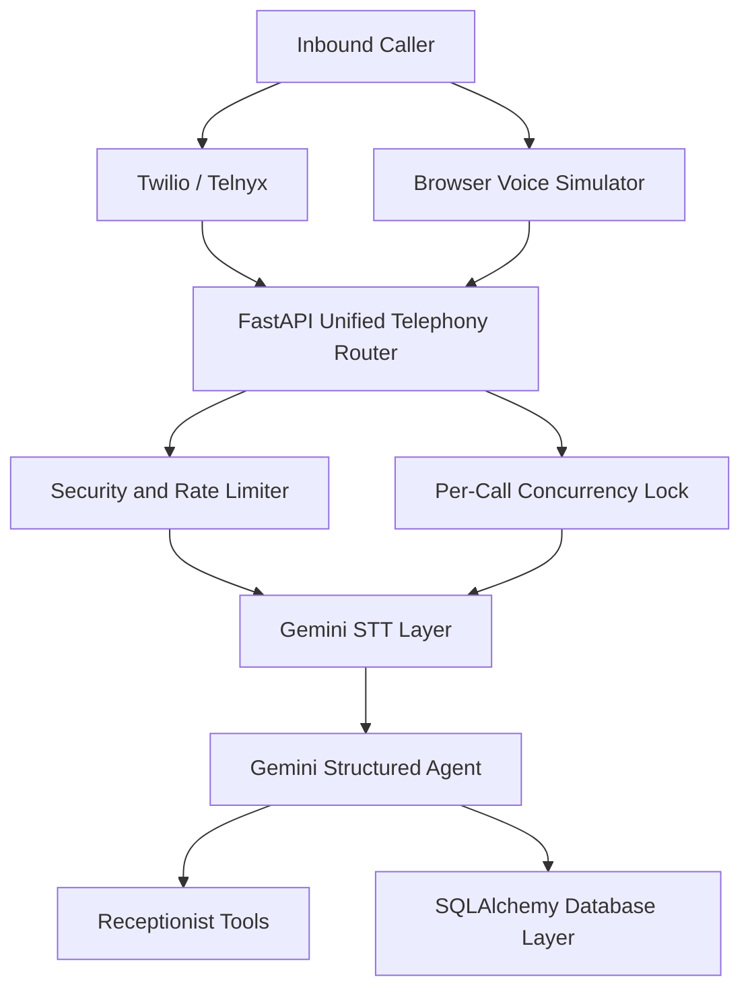

# AI Voice Receptionist & Autonomous Commercial Agent

A production-hardened, multi-tenant AI voice receptionist and business automation agent built with **FastAPI**, **SQLAlchemy**, **Google Gemini multimodal LLM**, and production-grade **telephony architecture (Twilio & Telnyx ready)**.

Designed for real-world enterprise deployments with strict caller privacy, two-step callback consent, concurrency protection, structured JSON grounding, and an interactive browser-based hardware voice simulator.

---

## Key Features & Architecture Hardening

### 1. Structured AI Voice Receptionist Engine

* **Multimodal Speech Processing**: Transcribes voice input with Google Gemini using anti-hallucination guardrails (`temperature=0.0`) and true audio signal analysis.

* **Structured JSON Agent Reasoning**: Gemini responds using strict schema-enforced JSON (`response_mime_type="application/json"`), ensuring predictable output and clean tool execution.

* **Grounding & Hallucination Guard**: Every answered query requires strict grounding against approved business knowledge items (`faq_id`). Unmatched or out-of-scope parts are automatically isolated.

* **Multi-Part Question Resolution**: Transparently answers all queries covered by approved knowledge in a single response, while explicitly identifying any unanswered aspects without generic apologies.

* **Multi-Turn Context Tracking**: Maintains conversational continuity bounded by `agent_context_messages` (default: 6 messages / 3 full turns), allowing callers to ask natural follow-up questions.

* **Two-Step Affirmative Callback Consent**:

  * Phone numbers are read back digit-by-digit (e.g., **"nine eight seven six..."**) before booking.

  * Strict confirmation required: bookings occur only upon explicit affirmation (**"yes"**, **"correct"**). Consent is never assumed or inferred from ambiguous phrases.

* **Safe Error Fallback**: Graceful degradation to neutral, professional fallback responses if LLM or network timeouts occur.

### 2. Privacy & STT Pipeline

* **3-Variant STT Status**: Distinct classification for `speech`, `no_speech` (silence/empty input), and `error` (transcription/API failure).

* **Zero Caller Transcript Logging**: Caller speech, transcripts, and voice payloads are **never logged** to server stdout or log files, guaranteeing caller privacy and compliance.

* **Distinct Caller Feedback**: Clear, specific audio feedback distinguishing microphone silence from processing errors.

### 3. Hardened Voice Simulator (`/admin/mock-call`)

* **Client Turn Gating**: Integrated `AbortController` cancels inflight requests and discards stale turn responses if a new turn starts or the call ends.

* **Hardware Mic Stream Lifecycle**: Explicitly stops all hardware microphone media tracks (`stream.getTracks().forEach(t => t.stop())`) and releases audio context on hang-up and `beforeunload`.

* **Real-time Web Audio API Waveform**: Canvas visualizer reactive only to actual microphone decibels (no synthetic CSS pulses).

* **Hardware Device Selector**: Enumerate and select any active input microphone/headset on your operating system.

* **Diagnostic Execution Badges**: Real-time visual feedback for FAQ matches, callback bookings, and enquiry escalations.

### 4. Concurrency & Data Integrity

* **Per-Call Concurrency Locks**: In-memory `asyncio.Lock` per `call_id` ensures rapid caller turns do not cause race conditions or lost updates.

* **Identity Map Cache Invalidation**: Explicit `db.expire_all()` ensures fresh transcript and state retrieval across concurrent requests in SQLAlchemy.

### 5. Security Perimeter & Admin Portal

* **Soft-Coded Admin Authentication**: Configurable `ADMIN_USERNAME` and `ADMIN_PASSWORD` (or bcrypt `ADMIN_PASSWORD_HASH`) managed entirely via `.env`.

* **Production Secret Validation**: Startup checks enforce strong `APP_SECRET_KEY` entropy and reject insecure default placeholders in production.

* **Endpoint Protection**: `login_required` enforcement across admin views, receptionist APIs, and simulator endpoints.

* **Rate Limiting**: `SlowAPI` limits on authentication, call initiation, turn processing, and webhook endpoints.

* **CORS Hardening**: Explicit origin controls via `CORS_ORIGINS`.

---

## Architecture



---

## Quickstart Guide

### 1. Prerequisites

* Python 3.11+

* A free [Google AI Studio Gemini API Key](https://aistudio.google.com/)

### 2. Clone and Setup Environment

```bash

git clone https://github.com/ufarooq8627/VoiceAgent.git

cd VoiceAgent

\# Create virtual environment

python -m venv venv

\# Activate virtual environment

\# Windows (PowerShell):

venv\Scripts\Activate.ps1

\# Linux/macOS:

source venv/bin/activate

\# Install dependencies

pip install -r requirements.txt

```

### 3. Configure Environment Variables

Copy `.env.example` to `.env`:

```bash

\# Windows:

copy .env.example .env

\# Linux/macOS:

cp .env.example .env

```

Edit `.env` with your credentials:

```env

\# Application Security

APP_SECRET_KEY=generate_a_random_secure_secret_key_here

ENVIRONMENT=development

\# Admin Authentication

ADMIN_USERNAME=admin

ADMIN_PASSWORD=your_secure_password_here

\# Gemini AI / LLM Configuration

LLM_PROVIDER=gemini

LLM_API_KEY=your_gemini_api_key_here

LLM_MODEL=gemini-3.5-flash-lite

\# Agent Context & Concurrency

AGENT_CONTEXT_MESSAGES=6

```

\> **Security Note**: In production (`ENVIRONMENT=production`), `APP_SECRET_KEY` must be at least 32 characters long and not use default placeholder values.

### 4. Initialize Database & Seed Demo Business

```bash

\# Initialize DB tables and seed the demo clinic (Apex Dental)

python -c "from app.database import Base, engine; Base.metadata.create_all(bind=engine)"

python -c "from app.scripts.seed_receptionist import seed; seed()"

```

### 5. Run the Server

```bash

uvicorn app.main:app --reload --port 8000

```

Open your browser at:

* **Voice Receptionist Simulator**: [http://localhost:8000/admin/mock-call](http://localhost:8000/admin/mock-call)

* **Customer Enquiries Dashboard**: [http://localhost:8000/admin/customer-enquiries](http://localhost:8000/admin/customer-enquiries)

* **Swagger API Documentation**: [http://localhost:8000/docs](http://localhost:8000/docs)

---

## Testing the Voice Simulator

1\. Log in at `http://localhost:8000/auth/login` using your configured admin credentials.

2\. Navigate to `http://localhost:8000/admin/mock-call`.

3\. Select your microphone from the **Microphone Input** dropdown.

4\. Click **"Test Mic"** to verify sound detection (VU volume meter reflects real decibels).

5\. Click **"Start Inbound Call"**.

6\. Click **"Mic"** to speak:

   * **FAQ Query**: **"Where is your clinic located and what are your opening hours?"**

   * **Multi-Part Query**: **"Where are you located, and do you perform pediatric cardiology?"**

   * **Two-Step Callback**: Ask to receive a callback, listen as the agent reads your number digit-by-digit, and reply with **"Yes, that is correct."**

7\. Click **"Hang Up"** to finalize the call. Notice that all hardware microphone tracks are cleanly released.

---

## Automated Test Suite

The project includes an enterprise-grade automated test suite verifying all security, grounding, concurrency, and conversation flows:

```bash

pytest -v

```

### Covered Test Modules:

* `tests/test_callback_consent.py`: Verifies digit-by-digit readback and strict affirmative confirmation.

* `tests/test_conversation_context.py`: Validates multi-turn context boundaries (`agent_context_messages`).

* `tests/test_transcript_concurrency.py`: Tests concurrent turn handling and race condition prevention.

* `tests/test_unanswered_logging.py`: Asserts correct database enquiry escalation for unknown queries.

* `tests/test_stt_error_path.py`: Tests 3-variant STT status and verifies zero caller voice logging.

* `tests/test_security_config.py`: Enforces secret entropy, bcrypt hashes, and production safety checks.

* `tests/test_agent_safety.py`: Prompt injection defenses and system instruction isolation.

* `tests/test_receptionist_agent.py`: End-to-end agent turn execution and tool invocation.

---

## Telephony Integration (Twilio & Telnyx)

### Local Webhook Tunneling with ngrok

Because telephony providers require public webhook URLs, expose your local server:

```bash

ngrok http 8000

```

### Twilio Configuration

1\. In your **Twilio Console**, navigate to your Phone Number settings.

2\. Under **"A Call Comes In"**, set:

   * **HTTP Method**: `POST`

   * **URL**: `https://your-ngrok-subdomain.ngrok-free.app/api/telephony/twilio/voice`

3\. Under **"Call Status Changes"**, set:

   * **URL**: `https://your-ngrok-subdomain.ngrok-free.app/api/telephony/twilio/status`

### Telnyx Configuration

1\. In **Telnyx Mission Control Portal** ? **TeXML Applications**.

2\. Set **Voice URL** to `POST https://your-ngrok-subdomain.ngrok-free.app/api/telephony/telnyx/voice`.

3\. Set **Status Callback URL** to `POST https://your-ngrok-subdomain.ngrok-free.app/api/telephony/telnyx/status`.

---

## Security & Privacy Notice

* **Zero Voice Logging**: Caller speech and audio transcripts are never written to disk or logs.

* **Credential Hygiene**: Git tracking ignores `.env`, SQLite database files, and sensitive keys.

* **Authentication**: All management and simulation routes require valid session authentication.
